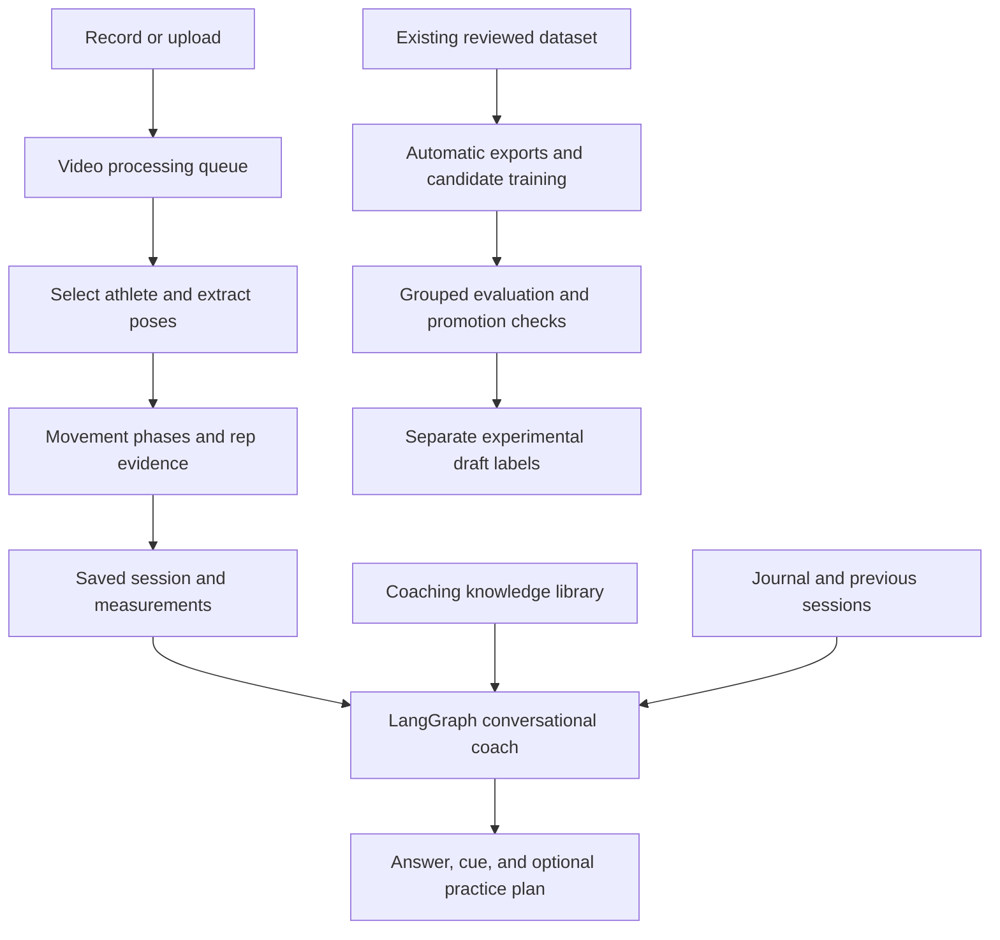

# FenceCoach — Project Overview and Completion Plan

Updated: October 9, 2026 (America/Toronto)

## 1. Goal

Build a fencing practice app that turns video into useful, conversational coaching.

The core experience is:

1. Record or upload a practice clip.
2. Track the selected fencer and identify exercise periods and repetitions.
3. Review timestamped movement evidence and compare repetitions.
4. Ask a coach natural questions, such as “What should I change in my lunge?”
5. Receive a supported observation, a practical cue, and an explanation of why it matters.
6. Save the session, log practice, and revisit progress over time.

The project also demonstrates practical AI engineering: LLM tool calling, LangGraph workflows, LangChain integrations, retrieval-augmented generation, computer vision, data provenance, automatic training, evaluation, and eventual cloud deployment.

### Current deadline

The user needs a usable project in one week. The working target is **October 16, 2026**. This is a milestone target, not a guarantee that recognition or coaching accuracy will reach a particular level by that date.

The week should produce a coherent, demonstrable MVP with a clearly defined footage scope. A broadly reliable coach for arbitrary competition footage is a longer-term goal.

## 2. Agreed MVP Scope

### Primary supported scenario

- One fencer doing deliberate practice.
- A fixed side-view camera with the whole body visible.
- Space to complete a lunge and recovery without leaving the frame.
- Initial emphasis on footwork and lunge/recovery practice.
- Short clips: the current upload limits are two minutes and 200 MB.

### Secondary scenario

- One fencing bout.
- Analyze one selected fencer; retain the opponent as context.
- Select the athlete by starting side or a crop when the view contains two fencers.
- Treat occlusion, camera movement, and uncertain action boundaries explicitly.

### Outside the one-week MVP

- Several simultaneous bouts or crowded group exercises in one frame.
- General tactical interpretation, blade contact, right-of-way, or scoring judgments.
- Expert-level technique grading across arbitrary athletes and camera views.
- Reliable flèche recognition without adequate examples and evaluation.
- Native mobile packaging and a mature account system.

Footwork is the initial shared foundation across foil, épée, and sabre. Weapon-specific technique and tactics need additional evidence and guidance.

## 3. What Is Implemented

“Implemented” means the code or local workflow exists. It does not mean every feature has been validated for real-world accuracy or production scale.

| Area | Current implementation | Remaining limitation |
|---|---|---|
| Interface | Red fencing-themed training, recording, review, coach, library, and journal screens | Complete usability and end-to-end checks remain |
| Recording and uploads | Browser camera recording, saved local drafts, server upload, playback previews | Supported footage and failure handling need clearer validation |
| Video processing | Timestamped MediaPipe pose extraction and 2D movement measurements | Low resolution, occlusion, multiple people, and athlete selection remain difficult |
| Athlete selection | Geometry continuity, location hints, crop handling, ambiguous-match abstention, separate tracking epochs | This is geometric tracking, not verified biometric identity |
| Rep analysis | Stance expansion/return proposals, proposed onset and peak, recovery intervals, exercise-set grouping, jump-to timestamps | Proposals remain heuristic; complete movement recognition is not validated |
| Measurements | Knee/elbow angles, torso tilt, arm-extension shape, timing, and normalized image motion | These do not establish technique correctness or real-world speed |
| Conversational coach | Local LLM integration, conversational history, optional evidence tools, retrieved notes, and grounded responses | Coaching usefulness and response latency still need benchmark results |
| Dataset review | Saved labels, per-label attribution, revision history, local interval editing, save-time overlap validation, draft filtering | This interface is optional for future automated runs; existing labels still seed training |
| Automatic training | Detect changed inputs, refresh exports, fit a candidate, run grouped diagnostics, check readiness, generate separate drafts | Independent automatic labeling is not implemented yet |
| Persistence | Local database for sessions, reviews, jobs, and practice logs; filesystem video artifacts | Multi-user ownership and cloud operation are unfinished |
| Cloud/container foundations | Docker/Compose and optional AWS Bedrock/S3 integration paths | These are not proof of a deployed or load-tested cloud product |

### Recent video and coaching changes

- Multi-person frames can be retained when geometric continuity identifies a sufficiently distinct athlete match.
- Ambiguous matches and large identity discontinuities are excluded.
- Tracking epochs prevent temporal training windows and proposed reps from crossing an uncertain reacquisition.
- A quiet upright stand is insufficient to seed the automatic guard baseline.
- Proposed movement onset can precede the large stance-expansion threshold, improving the evidence available for arm timing.
- With a moving or unknown camera, recovery image motion is named separately from fixed-camera recovery hip speed.
- The conversational coach receives a bounded set of actual measurements in its fast evidence path.
- The repetition inspection tool groups saved rep measurements; whole-clip summaries are not treated as additional repetitions.

These changes reduce known failure modes. They do not yet establish recognition or coaching accuracy.

## 4. Current Data and Model Status

### Saved reviews

Eight clips have saved human-reviewed labels. Their accepted labels and review histories have been preserved.

Two bout excerpts originally had a mismatch between their named label track and a default `primary` selection. The exporter now resolves this legacy alias only when there is one named active track and an existing crop. Ambiguous multi-track cases remain unresolved rather than silently reassigned.

### Latest MVP-scoped training run

At the time of this document:

- **Five reviewed clips** supplied usable training windows.
- **81 overlapping windows** were extracted.
- The usable sources form **two connected footage groups**.
- The run generated **three experimental movement drafts**.
- The candidate remains **unpromoted**.

These are a snapshot. Counts change when tracking, scope, or labels change. Overlapping windows are correlated; 81 windows are not 81 independent examples.

Three saved reviewed sources were excluded from the current MVP fit because they show multiple bouts or crowded group practice with unreliable target selection. Their labels remain available for future work.

Earlier runs reported larger window counts. Visual inspection showed that some recovered poses belonged to the wrong person. Those larger counts must not be presented as a validated improvement.

### What the movement model can currently claim

An experimental temporal classifier has been fitted from accepted pose windows. Recognition has **not** been demonstrated to generalize reliably to separate footage.

The classifier does not yet “know every action very well.” It also does not establish whether a recognized action was performed well. Those are two separate evaluation problems.

### Training automation today

The local server automatically:

1. Detects changed source metadata or saved labels.
2. Refreshes the relevant pose/annotation exports.
3. Fits an experimental gesture candidate.
4. Runs diagnostics with related footage kept in the same group.
5. Checks the stricter production collection gates.
6. Runs the strict trainer and promotion checks if readiness permits it.
7. Stores experimental predictions in separate draft sidecars.
8. Reports progress on the dataset page.

Unchanged inputs are skipped. A process lease prevents simultaneous training runs. Accepted labels are not overwritten by predictions.

**Not yet automatic:** obtaining independent, trustworthy labels from newly collected videos. The current model's drafts are not recycled as human ground truth.

## 5. Architecture and AI Skills

### LLM and agent engineering

- **LangGraph:** stateful conversational response/tool loops and the structured coaching-report workflow.
- **LangChain:** model integrations, tool definitions, and message handling.
- **Tools:** session measurements, reviewed rep timestamps, baseline comparisons, previous sessions, practice history, previous reviews, coaching-library search, and optional practice-plan preparation.
- **RAG:** local BM25 retrieval from an authored coaching library; an optional Bedrock embedding path exists.
- **Prompting:** conversational tone, question-specific evidence selection, explicit limits, and bounded context.
- **Grounding:** measurement/source attribution and checks intended to prevent unsupported technique claims.
- **Providers:** local Ollama and an AWS Bedrock integration path.

### Computer vision and ML engineering

- Timestamped pose extraction with coordinates mapped back into the original frame.
- Lower-body temporal features and visibility gates.
- Target selection and continuity checks.
- Reviewed versus automatic label separation.
- Source hashes, export freshness checks, crop provenance, and connected-source grouping.
- Experimental fitting separated from production readiness and promotion.

### Cloud and deployment engineering

Use one cloud platform well for the MVP. AWS is the most direct extension of the existing Bedrock/S3 hooks. Azure and GCP can be future integrations; they are not currently demonstrated project capabilities.

## 6. Main Bottlenecks

### A. Correct-athlete evidence

The detector can select a background person in crowded, low-resolution footage. One MIT group clip is only 320×240. A higher count of tracked frames is meaningless if those frames belong to someone else.

The current response is to narrow supported footage, honor athlete selection, inspect samples, and abstain when unresolved. Clear solo clips are the most practical MVP input.

### B. Recognition data and generalization

Some movements have very few usable examples. Related clips from one lesson or match do not provide independent validation. Several classes may be absent from a diagnostic fold's training data.

More automatic labels will help only if their quality is controlled.

### C. Coaching correctness

A joint angle alone rarely establishes a fault. Useful coaching needs the movement phase, relevant arm/leg identity, repeated patterns, camera context, and applicable technique guidance.

Expert-reviewed benchmarks would strengthen the product substantially. The user does not need to review every new clip, but zero manual labeling does not guarantee expert-level coaching accuracy.

### D. Response speed

The requested target is roughly **3–5 seconds** for an ordinary coaching reply. That target is not yet demonstrated. Separate video processing from chat, cache session evidence, keep the local model warm, bound tool calls, and measure first-response and completion latency.

## 7. One-Week Delivery Plan

Work can overlap. Each stage needs a reviewable result before the next claim is made.

| Stage | Planned focus | Completion evidence |
|---|---|---|
| Days 1–2 | Video reliability for solo practice and one selected fencer in a bout | Correct target overlays on representative clips; setup exclusion and rep timestamps checked against visible actions |
| Days 3–4 | Coaching quality and response speed | Relevant answers to lunge/arm/recovery questions; natural follow-ups; measured latency results |
| Day 5 | Complete practice flow | Record/upload → analysis → rep review → coach → saved practice log works without dead buttons or confusing states |
| Days 6–7 | Evaluation, failure cases, demo packaging | Reproducible demo clips, benchmark report, known limitations, restart instructions, and a stable demonstration |

### Must deliver for the MVP

- A working single-fencer record/upload flow.
- Correctly aligned pose overlays and explicit handling of uncertain tracking.
- Useful timestamped rep evidence and navigation between reps.
- Conversational answers that address the question and give supported practice guidance.
- Saved sessions and daily practice history.
- Automatic export/training workflow without manual command execution.
- A clear distinction between experimental recognition and validated behavior.
- A demo with real video evidence and reproducible results.

### Delivery choices

- Focus first on lunges and recovery, then basic advances/retreats where evidence supports them.
- Keep advanced tactics and flèche outside the week unless evaluated examples justify inclusion.
- Keep authentication toward the end, as requested.
- A dependable local MVP is the first milestone. Cloud deployment is an additional milestone; it should not substitute for video or coaching quality.

## 8. Remaining Work After the MVP

### Automatic data expansion

1. Add an independent video-labeling model or teacher.
2. Compare its labels with pose evidence and movement rules.
3. Store automatic labels with source, model version, agreement, and uncertainty.
4. Evaluate candidates against held-out reviewed footage before accepting an update.
5. Prevent evaluation footage from leaking into training.

This is the major unfinished part of the zero-manual-input training goal.

### Stronger recognition and coaching

- Expand independent athletes, recordings, and camera views.
- Evaluate each movement separately, including false detections during setup and walking.
- Validate rep boundaries and recovery timing.
- Improve hand/foot timing evidence.
- Add weapon-specific guidance and expert-reviewed coaching cases.
- Support longitudinal comparison under matching capture conditions.

### Production product

- Deploy API, workers, storage, and database.
- Add monitoring, retry visibility, resource limits, and operational checks.
- Establish model/data versions and rollback behavior.
- Add accounts, ownership, authorization, and cross-device persistence.
- Improve mobile browser use, then consider native mobile packaging.

## 9. Evaluation and Resume Metrics

Measure these before claiming success:

| Metric | Purpose |
|---|---|
| Correct-athlete tracking coverage and switch count | Check that measurements belong to the intended fencer |
| Exercise/setup classification precision and recall | Avoid counting walking into position as practice |
| Rep precision, recall, and boundary error | Measure whether reps and timestamps are useful |
| Per-movement precision, recall, and macro F1 | Evaluate recognition across supported actions |
| Performance on separate source groups/athletes | Detect memorization and footage-specific behavior |
| Coaching relevance and unsupported-claim rate | Evaluate whether feedback is useful and grounded |
| Median and p95 chat latency | Check the 3–5-second experience target |
| Video processing time relative to clip length | Quantify pipeline efficiency |
| End-to-end task completion and persistence | Verify the actual product flow |

Potential resume descriptions can emphasize the implemented LangGraph coach, RAG, tool calling, video-processing queue, provenance controls, and automated evaluation workflow. Accuracy gains, scale, and latency improvements must use measured results. Do not claim expert coaching, production cloud scale, or successful autonomous labeling before those are demonstrated.

## 10. Current Handoff

- Project: `outputs/fencecoach` in the current workspace.
- Local app: `http://127.0.0.1:8001/`.
- Dataset and training status: `http://127.0.0.1:8001/dataset`.
- Automatic training status API: `/api/datasets/automation`.
- Main modules: `video_pipeline.py`, `athlete_tracking.py`, `motion.py`, `footwork.py`, `automatic_training.py`, and `training_data.py`.
- Live conversational workflow: `src/fencecoach/coach/conversation.py`.
- Structured report workflow: `src/fencecoach/coach/graph.py`.
- Experimental trainer: `scripts/train_seed_gestures.py`.
- Strict trainer: `scripts/train_gestures.py`.
- Existing reviews: per-clip `labels.json` and `label-history` under `data/training`.
- Automatic outputs: candidate model JSON, readiness reports, and separate `automatic-drafts.json` sidecars.

Recent targeted checks passed for athlete continuity, location selection, guard gating, identity breaks, conversation evidence, dataset save/export behavior, and automatic-run caching. These checks do not validate real-world action or coaching accuracy.

**Immediate priority:** finish a dependable solo-practice video-to-coaching demo, benchmark it, and close the complete practice workflow within the one-week scope.
