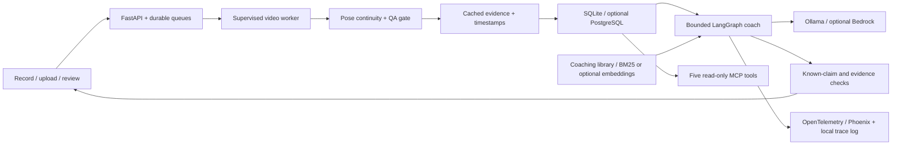
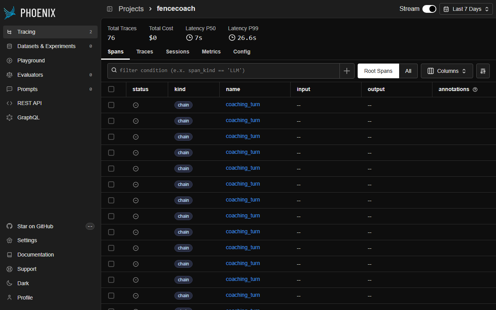

# FenceCoach

A local fencing practice app with a LangGraph conversational coach, evidence tools, retrieval, persistent session memory, and video measurements. Phase 1 targets **one fencer, a fixed side camera, full-body footage**. Flèche rules are beta. Bout analysis, learned classifiers, and automatic label drafts are experimental.

**Readiness:** the engineering flow works, but coaching correctness is not independently validated. None of the eight existing golden clips passes the stricter solo QA gate. The app blocks personalized video coaching on those clips. See [the validation path](docs/coaching-validation.md) and [measured benchmarks](BENCHMARKS.md).

## Run with Docker

Requires Docker Engine/Desktop with Compose, internet for initial downloads, and enough memory for the local model and app. From this repository:

```sh
docker compose up --build
```

Open [FenceCoach](http://127.0.0.1:8000) and [Phoenix traces](http://127.0.0.1:6006). The stack downloads `qwen2.5:1.5b`, installs checksum-verified pose weights, starts SQLite-backed workers, and seeds three preprocessed archival examples. No account or API key is required. First-start time depends on network and hardware; the under-ten-minute target has **not** been verified on a fresh machine. Docker is unavailable on the development machine; CI contains image-build and container API checks, which have not yet been run for this revision.

The three MIT examples demonstrate QA, overlays, and rep proposals. They are low resolution and **unsupported for personal coaching**. They are not quietly upgraded or assigned synthetic measurements. The separate **Try synthetic sample review** demonstrates the evidence/report workflow without claiming video accuracy. Select **Local AI** there for a real model conversation; **Sample report** is deterministic and makes no LLM calls.

All services bind to localhost. Sessions, clips, model downloads, and Phoenix data persist in named volumes. `docker compose down` stops the stack without deleting those volumes. Authentication and cloud deployment are deferred.

## Run with Python

Python 3.12+, Ollama, and the model are needed for local video and live coaching. On Windows:

```powershell
py -m venv .venv
.\.venv\Scripts\python.exe -m pip install -r requirements.lock -r requirements-video.lock
.\.venv\Scripts\python.exe -m pip install -e '.[dev,video]'
.\.venv\Scripts\python.exe scripts/setup_video.py
ollama pull qwen2.5:1.5b
$env:FENCECOACH_SEED_EXAMPLES='true'
.\.venv\Scripts\python.exe -m uvicorn fencecoach.api:app --host 127.0.0.1 --port 8000
```

Start Ollama first if its desktop service is not running. On this development computer `scripts/start_local.ps1` also supports the existing portable runtime. Copy `.env.example` to `.env` for optional settings. Saved sessions/reviews and logs live in SQLite; unsent camera drafts live in browser IndexedDB. Clearing browser storage deletes unsent drafts, not saved server sessions.

## Product flow

1. **Record/upload:** silent camera recording or a video under two minutes / 200 MB. Confirm the weapon/lead side, camera motion, and reusable camera setup name.
2. **QA:** supported, supported with warnings, or unsupported with filming tips. Resolution, full-body visibility, multiple poses, usable-frame coverage, camera-motion evidence, and track reacquisitions are checked. These are engineering heuristics, not calibrated accuracy guarantees.
3. **Review:** timestamped proposed reps, exercise regions, landmark overlays, and a 12-frame contact sheet. Proposals require review. Saving unsupported clips as personal coaching evidence is blocked, including older saved sessions.
4. **Coach:** a natural conversation over saved measurements and retrieved notes. Assessments aim for a timestamped observation, one cue, one drill, and its purpose. Ordinary follow-ups retain conversational history. Measurements are not correctness scores.
5. **Practice/progress:** persistent journal entries and drills. Comparisons require the same declared, named camera setup and capture details; different setups show **Not comparable**. Shorter return time alone is not an improvement claim.

## Architecture



The pipeline performs pose extraction once per clip and caches evidence; chat does not rerun video analysis. Direct questions use a compact generation path. History/comparison requests retain a bounded tool loop. Local models are warmed and responses are streamed through sentence checks. Those checks catch known failures; they do not prove all language is grounded.

The research catalog preserves study conditions, units, and references. It does not turn a reported elite athlete average into a universal “good lunge” threshold. Knee angles are 2D estimates; physical force, spinal curvature, blade contact, tactical intent, and end balance are not measured.

## AI engineering and evidence

- LangGraph workflows, LangChain providers, bounded tool calls, retrieval, persisted conversational context, and evidence-backed practice drafts.
- Fixed evaluation questions, source hashes, label revisions, code hashes, model comparisons, independent-group split guards, and explicit abstention.
- OpenInference-compatible tool/model/turn spans, trace IDs, available token counts, latency, and API fee estimates. Phoenix runs locally; question text, notes, credentials, and video content are omitted from exported spans. JSONL traces remain in `data/traces/coach.jsonl`.
- Read-only MCP tools for measurements, reps, comparison, practice history, and library retrieval. [Configuration and verification](docs/mcp.md).



The dashboard includes development and test runs; its aggregate latency is not the model-comparison benchmark. Use [BENCHMARKS.md](BENCHMARKS.md) for the fixed-case results and disclosed evaluation limits.

## Checks and benchmarks

```sh
python -m unittest discover -s tests -v
python -m ruff check src tests scripts
python -m ruff format --check src tests scripts
python -m playwright install chromium
python scripts/browser_smoke.py
python scripts/mcp_smoke.py
python -m fencecoach.evaluation
python scripts/benchmark.py
```

The browser smoke uses synthetic inference/model fixtures in a temporary database, while exercising real HTTP, workers, recording, persistence, and UI. It checks two uploads, rep seeking, chat, logs, reload, unsupported state, and 390px mobile layout. It proves wiring, not pose inference or expert coaching quality. Unit tests and protocol checks run in GitHub Actions.

The full golden videos remain local, with hashes/review revisions committed; `benchmark.py` needs those original training folders. Packaged examples are portable. Recorded evaluation artifacts are provided under `evals/results`; benchmark generation consumes current local runs rather than silently scoring archived answers as new executions.

```sh
python scripts/evaluate_coach.py --models qwen2.5:1.5b qwen2.5:3b
python scripts/evaluate_vision.py
python scripts/coach_review.py
```

`evaluate_vision.py` prepares 30 cases and pose proxies, and explicitly reports **not run** without authenticated vision models. Add `--execute --models MODEL_ID MODEL_ID` to execute Bedrock Converse calls; charges apply. Existing reviewed action labels are independent of predictions, but selected-athlete identity still needs verification. Technique questions have no accuracy score until independently answered. The authored ten-question retrieval set is a regression set, not a held-out coaching benchmark.

## Optional cloud and scaling paths

The separate `compose.scale.yaml` retains PostgreSQL and independent workers. It requires explicit password configuration, model setup, and shared storage; it is experimental and not the default demo. Private S3 adapters and Bedrock providers are implemented, but cloud deployment and throughput claims are unverified. Bedrock model IDs and normal AWS credentials are required; configured IDs alone do not prove access. Never place credentials in the repository or image. No LangGraph/LangChain account is required.

## What failed and what changed

- Background people and ambiguous frames could produce convincing wrong-athlete measurements. Tracking now abstains and QA restricts supported input to solo footage.
- Low-resolution public drills are useful regression fixtures but fail the product filming requirements. The three packaged demos expose that failure explicitly.
- Generic coaching substituted recovery advice for lunge questions and repeated raw data. Topic-specific evidence, shorter prompts, assessment checks, and concrete evidence-based fallbacks now address known cases; expert usefulness is still unmeasured.
- Local latency misses the requested 3–5 second target. The smaller model is the default, cached evidence and warming reduce overhead, and the benchmark reports actual timings. A hosted fast path needs authenticated access before it can be compared.
- Two connected recording groups cannot demonstrate generalized recognition. Automatic drafts remain separate from human review and automatic training is off by default.

## Demo and licensing

[Watch the 89-second rehearsal](docs/demo.mp4). It labels synthetic sample coaching and shows actual Phoenix traces plus the recorded official-SDK MCP check. It does not imply a Claude client integration was exercised.

The three packaged sources and derived previews/contact sheets are attributed MIT OpenCourseWare PE.740 Fencing (Spring 2007), Prof. Jaroslav Koniusz, under **CC BY-NC-SA 3.0**. Per-file source links, checksums, and attribution are in [the example manifest](examples/video/manifest.json) and each `source.json`. These assets are noncommercial and share-alike; they are not covered by an assumed code license. No uploaded personal videos or unlicensed bout MP4s are committed.

## Next acceptance work

See [five-stage status](docs/finish-status.md) and [reliable coaching validation](docs/coaching-validation.md). Missing external acceptance items are clean supported solo/flèche clips, independent coaching references/usefulness ratings, authenticated hosted model comparisons, Claude-client integration, and a fresh-machine Docker run. Accounts, native mobile, and crowded-bout tactics remain outside this release.

Implementation references: [LangGraph](https://docs.langchain.com/oss/python/langgraph/graph-api), [MCP Python SDK](https://github.com/modelcontextprotocol/python-sdk/tree/v1.x), [Phoenix](https://github.com/Arize-ai/phoenix), [Bedrock Converse](https://docs.aws.amazon.com/bedrock/latest/APIReference/API_runtime_Converse.html), [Ollama Docker](https://docs.ollama.com/docker), [Compose startup order](https://docs.docker.com/compose/how-tos/startup-order/).
