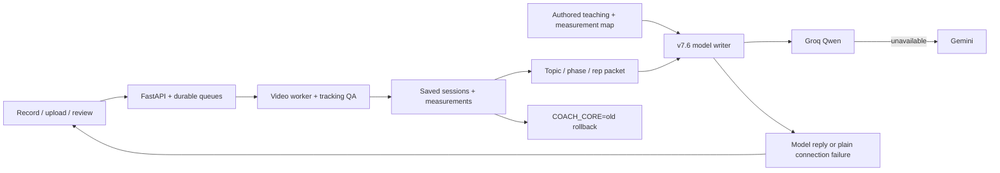

# Flèche

The app is named Flèche. The `fencecoach` Python package, existing `FENCECOACH_*`
settings and browser storage keys retain their legacy identifiers for compatibility.
Verbatim historical evaluation transcripts preserve their original wording.

A local fencing practice app with a LangGraph conversational coach, evidence tools, retrieval, persistent session memory, and video measurements. Phase 1 targets **one fencer, a fixed side camera, full-body footage**. Flèche rules are beta. Bout analysis, learned classifiers, and automatic label drafts are experimental.

**Readiness:** the engineering flow works, but coaching correctness is not independently validated. None of the eight existing golden clips passes the stricter solo QA gate. The app blocks personalized video coaching on those clips. See [the validation path](docs/coaching-validation.md) and [measured benchmarks](BENCHMARKS.md).

## Run with Docker

Requires Docker Engine/Desktop with Compose, internet for initial downloads, and enough memory for the local model and app. From this repository:

```sh
docker compose up --build
```

Open [Flèche](http://127.0.0.1:8000) and [Phoenix traces](http://127.0.0.1:6006). The stack downloads `qwen2.5:3b`, installs checksum-verified pose weights, starts SQLite-backed workers, and seeds three preprocessed archival examples. No account or API key is required. First-start time depends on network and hardware; the under-ten-minute target has **not** been verified on a fresh machine. The local Docker CLI is available and the Compose manifest validates, but the image build and container API smoke check have not been run for this revision.

The three MIT examples demonstrate QA, overlays, and rep proposals. They are low resolution and **unsupported for personal coaching**. They are not quietly upgraded or assigned synthetic measurements. The separate **Try synthetic sample review** demonstrates the evidence/report workflow without claiming video accuracy. Select **Local AI** there for a real model conversation; **Sample report** is deterministic and makes no LLM calls.

All services bind to localhost. Sessions, clips, model downloads, and Phoenix data persist in named volumes. `docker compose down` stops the stack without deleting those volumes. Authentication is not included.

## Full hosted demo (Render)

The [`render.yaml`](render.yaml) Blueprint deploys the full web app as one Docker service: browser UI, API, video-analysis worker, coaching worker, SQLite session history, uploaded clips, and the packaged example sessions. It enables the optional video dependencies and checksum-pinned pose model during the image build. Set `GEMINI_API_KEY` in Render when prompted; keep the key out of Git and the Docker image.

Video inference needs a paid `2c-4g` service and a 10 GB persistent disk. The disk keeps uploads and sessions between restarts, but the single-instance SQLite demo cannot be horizontally scaled, and Render briefly stops it during deploys. Render shows the current charge before the service is created. The Blueprint is ready for a connected GitHub repository, but a hosted build and live smoke test are still required before sharing its URL.

## Run with Python

Python 3.12+ is required. The default coach uses the configured Groq/Gemini keys;
Ollama is optional for the retained legacy local path. On Windows:

```powershell
py -m venv .venv
.\.venv\Scripts\python.exe -m pip install -r requirements.lock -r requirements-video.lock
.\.venv\Scripts\python.exe -m pip install -e '.[dev,video]'
.\.venv\Scripts\python.exe scripts/setup_video.py
$env:FENCECOACH_SEED_EXAMPLES='true'
.\.venv\Scripts\python.exe -m uvicorn fencecoach.api:app --host 127.0.0.1 --port 8000
```

For the legacy local path, start Ollama first. On this development computer `scripts/start_local.ps1` also supports the existing portable runtime. Copy `.env.example` to `.env` for optional settings. Saved sessions/reviews and logs live in SQLite; unsent camera drafts live in browser IndexedDB. Clearing browser storage deletes unsent drafts, not saved server sessions.

## Session coach — fewshot-v7.6.1

The default `COACH_CORE=new` answers questions about the loaded session, gives
verdicts against usual qualitative coaching cues, and compares your own reps when
there is no published standard. It uses available arm, knee, torso, recovery and
relative hip-speed readings, retaining topic and rep across follow-ups.
When saved, phase-matched comparisons with your chosen reference lunges are
available, it uses them as examples with their reviewer corrections, rather than
as universal targets. Whole-clip rejection can coexist with usable local rep
geometry; rejected reps and whole-clip summaries remain withheld.

“How good?” is decided for the measured topic: agreement with a coaching cue can
support a positive verdict; mixed readings call for an inconsistent verdict;
readings that contradict the cue call for a negative verdict. Where no standard
exists, such as recovery duration or relative hip speed, the coach compares your
own reps without inventing a numerical pass/fail boundary. None is published for
these app measurements. Readings are 2D estimates, not correctness scores.

The coach cannot assess blade control, force, calibrated speed or metres per
second, distance travelled, arm-versus-foot sequencing, inward knee collapse or
rear-foot roll. Flèche discussion is limited to general principles in the authored
material. Finish angles do not establish earlier movement or tactical effects.
`knowledge/reference_ranges.md` remains unapproved and unloaded.

Provider order is **Groq Qwen → Gemini → a plain failure message**:
“I couldn't reach the model, try again shortly.” The new core uses the existing
free tiers with daily limits and cooldowns; it has no local-model fallback.
No billing, extra accounts or extra keys are required. The model writes the reply
without output checkers, guards, templates or sentence deletion.
For use without live quota, [watch the recorded demo](docs/demo.mp4); it is an
older recorded rehearsal, not proof of the current coach's accuracy.

The owner reviewed the live acceptance and approved this default on October 18,
2026: zero hard failures across the 13 reviewed v7.6 retest replies, all eight
acceptance criteria PASS, including a real Groq-to-Gemini switch. Criterion 7 is
input-only tracking/athlete-selection evidence, not model-quality evidence.
There were 11 soft-slip turns. This result does not establish broader accuracy.
The v7.6.1 evidence fixes have automated regression coverage; the earlier live
acceptance result applies to the frozen v7.6 replies, not this updated revision.
See [full acceptance transcripts](docs/live_acceptance.md),
[rating sheets](docs/rating_sheet.md) and [pass notes](docs/pass_notes.md).

Known limitations from those soft slips:

- “That's solid” recurs across different topics.
- “Why does that matter?” answers sometimes claim more than a finish angle shows,
  including drive, balance or recovery benefits.
- Cues repeat across turns in a chain.
- “Every rep” sometimes includes a rep with no reading.
- A varying series is occasionally compressed into a trend.

For a one-setting rollback, put `COACH_CORE=old` in the ignored `.env` file and
restart the app. The old implementation remains in the code. Remove that override
(or set `COACH_CORE=new`) and restart to restore the new default.

## Legacy Gemini coaching (`COACH_CORE=old`)

With `COACH_CORE=old`, the legacy coach is an LLM with read-only evidence tools. It decides which tools to
use and writes the conversational reply. Application-owned state carries subject,
phase, role and repetition coverage across turns; the latest athlete message remains
the model's actual question. Gemini is primary, with a cooldown and local failover
for quota, timeout and transient provider errors.

Measurements and references retain their feature, phase, rep, units and provenance.
The writer's answer passes evidence and conversation checks before publication;
Gemini also receives an independent semantic review and a bounded repair opportunity.
These checks reduce errors without proving all free-form claims correct. The earlier
fixed-phrasing selector remains an explicit diagnostic option with
`FENCECOACH_VERIFIED_DIALOGUE=true`. See [the conversation design and validation](docs/conversational-coach.md).

The audit, measured results and remaining limits are in [the audit](docs/coach_audit.md)
and [the evaluation report](docs/coach_audit_results.md). Replay saved-session cases with
`python scripts/eval_coach.py --phase after --providers gemini local --run-id my-run`.
`--engine verified --offline` checks the selector protocol and evidence without claiming model quality or latency;
`--forced-switch` verifies the 429/cooldown conversation independently of real quota.

Create a key in [Google AI Studio](https://aistudio.google.com/api-keys), then save `GEMINI_API_KEY` in the ignored server `.env` file. Never put it in browser code or commit it. Install the project dependencies, then run `python scripts/configure_gemini.py`: it lists available models, makes one generic coaching request, and selects Gemini as the default only after success. Restart the server and refresh the app; choose **Gemini AI** in the coach. API usage is subject to Google quotas and billing settings. The setup command does not enable billing.

`GEMINI_CHAT_MODEL` defaults to `gemini-3.8-flash`; change it if unavailable to your account. Gemini uses the existing LangGraph conversation, evidence tools and local retrieval library. Messages and relevant measurements/history are sent to Google; video files are not sent by this chat integration. The configured flag means a key exists, not that account quota is available. Ollama and AWS remain selectable. A low reasoning setting and no automatic retries limit extra delay, but responses are not guaranteed within 3–5 seconds. The initial direct setup response took about 7 seconds; this is not a conversational quality benchmark.

Implementation references: [LangChain Gemini integration](https://docs.langchain.com/oss/python/integrations/chat/google_generative_ai), [Google thinking configuration](https://ai.google.dev/gemini-api/docs/thinking).

## Product flow

1. **Record/upload:** silent camera recording or a video under two minutes / 200 MB. Confirm the weapon/lead side, camera motion, and reusable camera setup name.
2. **QA:** supported, supported with warnings, or unsupported with filming tips. Resolution, full-body visibility, multiple poses, usable-frame coverage, camera-motion evidence, and track reacquisitions are checked. These are engineering heuristics, not calibrated accuracy guarantees.
3. **Review:** timestamped proposed reps, exercise regions, landmark overlays, and a 12-frame contact sheet. Proposals require review. Saving unsupported clips as personal coaching evidence is blocked, including older saved sessions.
4. **Coach:** ask about the loaded session and its usable measurements. The default model receives the session packet and authored teaching material, retaining conversational focus across follow-ups. Drills or next steps are requested explicitly. Measurements are not correctness scores.
5. **Practice/progress:** persistent journal entries and drills. Comparisons require the same declared, named camera setup and capture details; different setups show **Not comparable**. Shorter return time alone is not an improvement claim.

## Coach feedback workspace

Choose **Coach feedback · review frame by frame** from movement review, or open `/coach-review/<video-job-id>`. The workspace keeps video beside one form per rep, supports native seeking, slow playback, frame stepping, and attaching the displayed frame as evidence. It displays milliseconds for video and original-source timing; this does not increase the pose-sample resolution. Set the source offset in clip details for trimmed footage.

Draft feedback autosaves to the server with a browser backup. Saves use revisions to prevent another reviewer being silently overwritten. Submission requires an author, intended drill, and each rep's assessment; corrections additionally require a timestamp, visible reason, cue, and improvement check. JSON export preserves attribution. Reviewer roles are self-declared, and submission does not automatically promote feedback into training ground truth. A localhost URL is accessible on the computer running Flèche.

## Architecture



The pipeline extracts pose once per clip and caches evidence; chat does not rerun
video analysis. The default writer receives a compact packet and completed recent
exchanges, with no output checkers or rewriting. The retained legacy path has its
older retrieval, tool-loop and review behavior. Tests of that path do not establish
quality of the new model's prose.

The research catalog preserves study conditions, units, and references. It does not turn a reported elite athlete average into a universal “good lunge” threshold. Knee angles are 2D estimates; physical force, spinal curvature, blade contact, tactical intent, and end balance are not measured.

## AI engineering and evidence

- LangGraph workflows, LangChain providers, bounded tool calls, retrieval, persisted conversational context, and evidence-backed practice drafts.
- Fixed evaluation questions, source hashes, label revisions, code hashes, model comparisons, independent-group split guards, and explicit abstention.
- OpenInference-compatible tool/model/turn spans, trace IDs, available token counts, latency, and API fee estimates. Phoenix runs locally; question text, notes, credentials, and video content are omitted from exported spans. JSONL traces remain in `data/traces/coach.jsonl`.
- Read-only MCP tools for measurements, reps, comparison, practice history, and library retrieval. [Configuration and verification](docs/mcp.md).


The dashboard includes development and test runs; its aggregate latency is not the model-comparison benchmark. Use [BENCHMARKS.md](BENCHMARKS.md) for the fixed-case results and disclosed evaluation limits.

## Checks and benchmarks

```sh
python -m unittest discover -s tests -v
python -m ruff check src tests scripts
python -m ruff format --check src tests scripts
python -m playwright install chromium
python scripts/browser_smoke.py
python scripts/mcp_smoke.py
python -m fencecoach.evaluation
python scripts/benchmark.py
```

The browser smoke uses synthetic inference/model fixtures in a temporary database, while exercising real HTTP, workers, recording, persistence, and UI. It checks two uploads, rep seeking, chat, logs, reload, unsupported state, and 390px mobile layout. It proves wiring, not pose inference or expert coaching quality. Unit tests and protocol checks run in GitHub Actions.

The full golden videos remain local, with hashes/review revisions committed; `benchmark.py` needs those original training folders. Packaged examples are portable. Recorded evaluation artifacts are provided under `evals/results`; benchmark generation consumes current local runs rather than silently scoring archived answers as new executions.

```sh
python scripts/evaluate_coach.py --models qwen2.5:1.5b qwen2.5:3b
python scripts/evaluate_vision.py
python scripts/coach_review.py
```

`evaluate_vision.py` prepares 30 cases and pose proxies, and explicitly reports **not run** without authenticated vision models. Add `--execute --models MODEL_ID MODEL_ID` to execute Bedrock Converse calls; charges apply. Existing reviewed action labels are independent of predictions, but selected-athlete identity still needs verification. Technique questions have no accuracy score until independently answered. The authored ten-question retrieval set is a regression set, not a held-out coaching benchmark.

## Optional cloud and scaling paths

The separate `compose.scale.yaml` retains PostgreSQL and independent workers. It requires explicit password configuration, model setup, and shared storage; it is experimental and not the default demo. Private S3 adapters and Bedrock providers are implemented, but scalable cloud deployment and throughput claims are unverified. Bedrock model IDs and normal AWS credentials are required; configured IDs alone do not prove access. Never place credentials in the repository or image. No LangGraph/LangChain account is required.

## What failed and what changed

- General questions containing “I” or “my” were routed to a fixed video refusal. Desired-technique questions now inspect matching session measurements when available, then use general teaching references when the clip cannot establish an answer. General instruction does not require a timestamp or practice drill; measurement and unsupported-claim checks still apply. Arm direction and elbow bend are treated as different angle questions.

- Background people and ambiguous frames could produce convincing wrong-athlete measurements. Tracking now abstains and QA restricts supported input to solo footage.
- Low-resolution public drills are useful regression fixtures but fail the product filming requirements. The three packaged demos expose that failure explicitly.
- Generic coaching substituted recovery advice for lunge questions and repeated raw data. Topic-specific evidence, shorter prompts, assessment checks, and concrete evidence-based fallbacks now address known cases; expert usefulness is still unmeasured.
- Clarifications repeated an earlier wrong sideways-arm instruction. General questions now retrieve technique notes using the latest topic; follow-ups must answer the current question, copied sentences are checked before streaming, and known arm-role/return-to-guard failures use cited reference responses. The 3b local model is now the default after a five-question diagnostic comparison; it still needed three reference replacements. This narrow check does not establish broad conversational or coaching accuracy. Replay it with `python scripts/evaluate_clarifications.py --model qwen2.5:3b`.
- Rejected legacy clips previously left chat appearing unresponsive. The composer now shows the filming issue and inline request errors, offers sample chat, and supports Enter to send. General questions remain available with rejected measurements and evidence histories removed. Personal questions receive a saved missing-evidence reply instead of an HTTP 422; this reply makes no model call or technique finding. Missing or failed saved jobs restore the composer. Invalid request fields still return validation errors.
- The earlier 1.5b routine path measured 2.04 seconds median / 3.15 seconds p95 across 27 diagnostic requests. Five fixed clarification checks and three sequential follow-ups on the newer 3b default measured 1.09–2.44 seconds before queue/browser overhead; broader 3b latency is not remeasured yet. The diagnostic results are archived in `evals/results/clarifications-qwen2.5-3b.json`. Cold starts, queued requests, and multi-tool plans can take longer. See [BENCHMARKS.md](BENCHMARKS.md); faster answers do not establish expert coaching quality.
- Two connected recording groups cannot demonstrate generalized recognition. Automatic drafts remain separate from human review and automatic training is off by default.

## Demo and licensing

[Watch the 89-second rehearsal](docs/demo.mp4). It labels synthetic sample coaching and shows actual Phoenix traces plus the recorded official-SDK MCP check. It does not imply a Claude client integration was exercised.

The three packaged sources and derived previews/contact sheets are attributed MIT OpenCourseWare PE.740 Fencing (Spring 2007), Prof. Jaroslav Koniusz, under **CC BY-NC-SA 3.0**. Per-file source links, checksums, and attribution are in [the example manifest](examples/video/manifest.json) and each `source.json`. These assets are noncommercial and share-alike; they are not covered by an assumed code license. No uploaded personal videos or unlicensed bout MP4s are committed.

## Next acceptance work

See [five-stage status](docs/finish-status.md) and [reliable coaching validation](docs/coaching-validation.md). Missing external acceptance items are clean supported solo/flèche clips, independent coaching references/usefulness ratings, authenticated hosted model comparisons, Claude-client integration, and a fresh-machine Docker run. Accounts, native mobile, and crowded-bout tactics remain outside this release.

Implementation references: [LangGraph](https://docs.langchain.com/oss/python/langgraph/graph-api), [MCP Python SDK](https://github.com/modelcontextprotocol/python-sdk/tree/v1.x), [Phoenix](https://github.com/Arize-ai/phoenix), [Bedrock Converse](https://docs.aws.amazon.com/bedrock/latest/APIReference/API_runtime_Converse.html), [Ollama Docker](https://docs.ollama.com/docker), [Compose startup order](https://docs.docker.com/compose/how-tos/startup-order/).
# Submitted technique feedback and personalized coaching

## Automatic evaluation across clips

Each analyzed clip now exposes `/api/videos/{job_id}/technique`: visible frames
near each lunge bookmark, knee angles, separate knee-to-toe projection, torso
pitch change, weapon-arm direction, return stance and sampled action timing.
The evaluator runs without human technique text. Explicit solo-drill heuristics
produce provisional review flags with timestamps and practice cues. Thresholds
are versioned development rules, not validated universal technique cutoffs.
View and anatomical roles may be inferred from consistent landmark geometry;
declared capture roles take precedence. New uploads offer a camera-view selector.
Poor setup/exit framing excludes whole-clip metrics but can leave individual reps
usable. Missing joints disable their checks; moving cameras, multiple people,
tracking identity breaks and low-resolution sources retain rejection gates.

The conversational coach receives the evaluation through an evidence tool and
attributed source. Submitted human review remains the stronger reference when
available. Ask for an automatic evaluation to inspect geometry-only findings.
`python scripts/evaluate_technique.py` saves evaluation reports for existing clips
to `data/technique-evaluations`. Related recordings are not independent validation
data. No technique classifier weights are trained or promoted by this evaluator.

Submitted coach reviews are loaded into session chat through the reviewed-feedback
tool and attributed sources. Drafts are excluded. Submission recalculates rep
geometry using corrected frame bookmarks, preserving the existing session ID and
unrelated clip measurements. Finish-to-guard intervals include holds; they are
not active recovery speed. The submitted revision and examples are saved in the
same transaction. Intentional variations retain their stated corrections.

Run `python scripts/prepare_coach_learning.py` to integrate existing submissions
and export `data/coach-learning/technique-examples.jsonl`, review snapshots and
the readiness report. The running local app is not required for this command.
This prepares personalized retrieval data, not LLM fine-tuning or gesture training.
Reference-rated reps that also list issues are mixed examples, not flawless
negative examples. Free text is not silently turned into per-issue classifier
targets; independent recordings and explicit labels are needed for supervised
technique evaluation. Sparse action/lunge/guard anchors are not dense phase labels.


### Phase measurements and existing-clip audit

The v3 solo-lunge evaluator summarizes each repetition separately: starting guard,
lunge drive, observed lunge hold (or an explicit finish-window fallback), active
recovery, deepest observed rear-knee recovery bend, and returned guard. Geometry
uses visible samples within the matching phase, with sample counts, ranges and
representative timestamps. It does not use a whole-clip median to grade a rep.
Phase boundaries and flags remain heuristic proposals, not expert-validated labels.

`python scripts/evaluate_technique.py --contact-sheets` audits all stored uploads
without changing saved reviews. Open `/api/videos/technique-audit` on the running
server for the report, frame sheets and phase jumps. Duplicate/related uploads
are grouped by source hash and must not count as independent validation footage.
Unsaved older analyses refresh movement proposals from cached pose samples;
saved rep timings remain unchanged.

`python scripts/evaluate_coach_contract.py` checks question routing, topic-specific
evidence selection and per-rep answer coverage against the latest saved
reference-comparison request in the local database. It makes no model/API calls
and writes only aggregate results to the ignored
`data/evals/coach-contract-latest.json`. This checks that the right evidence reaches
the answer path; it does not validate the coaching criteria or prove that a
measured difference is a technique fault.

Live Gemini conversation now uses one complete session evidence packet for every
question, including per-rep phase measurements, their meanings, submitted feedback,
and reference comparisons. The answer generator cites exact internal record IDs;
a structured reviewer checks the question's relevance and the interpretation of
those same records before prose is displayed. Personal corrections must cite a
supplied reference correction or submitted feedback. New measured features enter
the same flow without adding a question category or a canned reply.

Rejected drafts are repaired against the same question and evidence. Provider
failures never produce substitute technique feedback. A transient Gemini failure
can try `GEMINI_FALLBACK_MODEL` with the same context; quota errors are reported as
quota errors, with the question retained. Gemini deadlines use
`GEMINI_REQUEST_TIMEOUT_SECONDS` (default 12, minimum 10 allowed by Google).
The generation and semantic review are separate API calls; a healthy provider
is required to exercise this live path. Regression checks:
`python -m unittest discover -s tests -p test_coach_response_reliability.py`.

Save reviewed practice is available once a rep interval or supported clip
measurement is selected. The server validates edited timings and local evidence
on save. Failed saves display a reason beside the button and leave edits in place;
a loading cursor appears only while the save request is in progress.

### Athlete review and interrupted chat

The Review tab shows video, numbered repetitions, phase jumps and plain-language
review flags. Selecting a rep updates its feedback without recreating the video
player. Session measurement tables are optional details. Athlete pages no longer
expose measurement JSON import controls.

Chat provides Stop and retains the question after failures. Polling is bounded
(55 seconds for cloud, 100 seconds for local), with individual status requests
limited to 8 seconds. The supervisor also marks overlong running jobs failed;
late results from cancelled/failed jobs are not saved. Stop cancels the application
job, not necessarily an already dispatched remote provider computation. Provider
connection errors are distinguished from evidence validation errors. Gemini's
HTTP client has an explicit 20-second timeout; this does not promise replies in
3–5 seconds or repair an unavailable network/provider.

Gemini connections default to IPv4 (`GEMINI_FORCE_IPV4=true`) to avoid the
observed hanging IPv6 route on this development computer. This is limited to the
Gemini HTTP transport and does not change Windows/router networking. Set
`GEMINI_FORCE_IPV4=false` to use the SDK's default transport, including environment
proxy handling, on a different deployment.

### Athlete-supplied lunge drill benchmarks

`src/fencecoach/lunge_benchmarks.json` defines the current custom targets:
front-foot lift to observed stable finish below 0.4 seconds is fast, 0.4–0.5 is
normal, and above 0.5 is slow. Timing requires a visible lift and an observed
stable hold; old action-start bookmarks are not substituted. Sampling allowances
that cross a boundary produce a borderline result.

Feet separation uses the median projected horizontal heel/toe-centre separation
at the finish, divided by the starting rear leg's hip–knee plus knee–ankle segment
length. The athlete's approximate guide is two leg lengths, with no pass/fail tolerance. This needs a side view and visible
feet. Rear-foot displacement is also exposed in pixels and torso lengths, but its
12-inch target remains unevaluated without physical distance calibration. Neither
foot travel nor timing measures force or power. These targets are drill criteria,
not universal technique standards or trained model labels. Capture profiles can
override complete `timing`, `reach`, or `rear_foot` groups via `lunge_benchmarks`.

### Reference-first coaching

The main review and conversational coach compare matching phases with the latest
submitted reference set. The current agreed set is reps 1 and 4 of the reviewed
home recording. Reference measurements are recomputed from the saved footage and
corrected bookmarks, then cached by file modification time and review revision.
Stated corrections on a reference rep exclude that aspect from positive targets.
Self-comparisons are excluded. New clip labels are never copied from reference labels.

Posture and normalized reach can be compared provisionally between supported side
views. Timing comparisons across recordings require a matching declared camera
setup, weapon and drill; force is not measured. The review shows phase-matched
values and comparison cues, with fixed drill targets collapsed as optional details.
This is example-based comparison, not newly trained classifier weights, and it has
not established accuracy on an independent set of athletes or recordings.

### Rep proposal refinement

`guard-cycles-v3-local-drive-return` tracks a quiet starting guard separately for
each action, uses one fixed body scale through that action, requires sustained
leg separation and visible forward-foot travel, and closes the cycle on return
to that starting stance with backward hip motion. Small stance resets are omitted.
Knee-depth/asymmetry gates do not determine whether an imperfect lunge counts.
Identity breaks and tracking gaps reset the detector. These are movement-detection
heuristics, not trained gesture classifications or technique scores.

Unsaved older analyses refresh these proposals from cached pose samples when
opened, without uploading or processing the video again. Saved review intervals
and submitted coach bookmarks retain their original timings.
